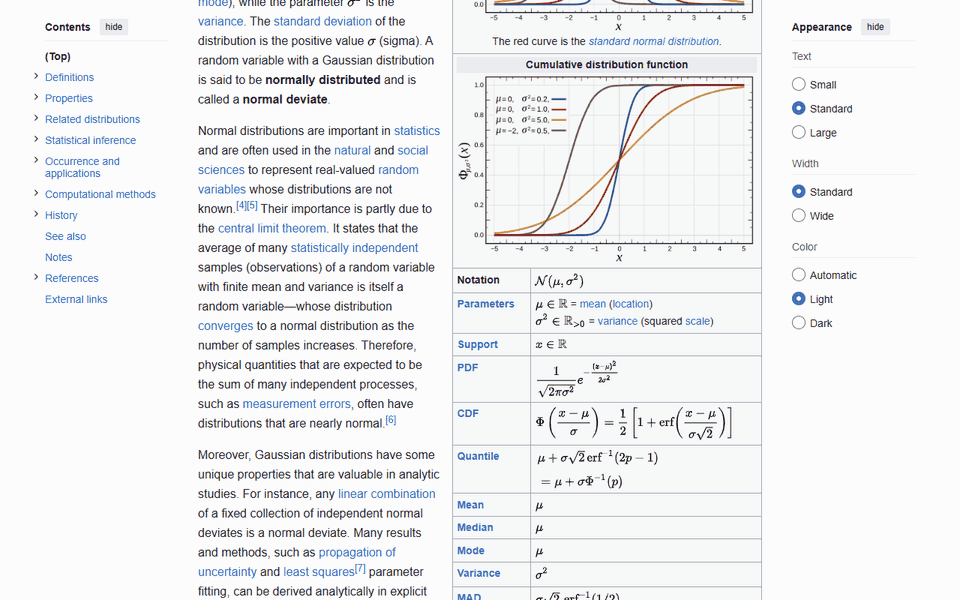

# WebPenPresenter

Point, highlight and write on any web page while you share your screen. A laser
pointer that remembers what you just wrote, a highlighter, a pen and an eraser, drawn
on top of the site you are teaching from. Nothing to install on the students' side,
nothing sent anywhere.



## Who it is for

Anyone who teaches or presents from a browser: a textbook site, an online calculator,
a news article, a learning platform, a slide deck in the browser. Screen sharing shows
pixels, so a pencil or a mouse hovering over a page is invisible to the room unless the
page itself draws it. WebPenPresenter draws it.

It was made for an instructor on an iPad with an Apple Pencil teaching over Zoom, and
it works just as well on a computer with a mouse, in Chrome or Edge.

## The tools

One small bar at the bottom left of the page. Tap a tool and the pen or pencil becomes
that tool, while fingers keep scrolling and tapping the page as usual.

- **Laser.** A red dot follows the pen. Press and write, and the strokes stay together
  as a note ("12 + 7 = 19", stroke by stroke), then fade on their own two seconds after
  the last lift. A quick tap presses whatever button sits under the dot, so you point
  and click with the same hand.
- **Mark.** A translucent yellow highlighter that stays until you clear it.
- **Pen.** A red or blue line that stays until you clear it. **Thick** doubles its width.
- **Box** and **Oval.** Drag corner to corner for a rectangle or an ellipse in the pen's
  color and width; sides that come out nearly even snap to a square or a circle, since a
  pen has no Shift key. **Fill** tints the inside and lets the page show through.
- **Erase.** Rubs out part of a line or a mark, or a whole shape.
- **Undo** and **Clear.** Take back the last stroke, or wipe everything.
- **Finger.** Lets fingers and the mouse draw too, for a tablet without a pen or a
  laptop with a trackpad. While it is on, the page cannot be tapped.
- **Hide.** Puts the bar away and leaves a small Pointer button to bring it back.

Marks are anchored to the page, so they stay on the sentence you drew them on when you
scroll. On the iPad the bar follows the visible area through pinch zoom, Split View and
Stage Manager, and your settings survive a reload within the same tab.

## Where it works

| | iPad (Safari) | Computer (Chrome, Edge) |
|---|---|---|
| How | A bookmark, set up once at [webpen-presenter.netlify.app](https://webpen-presenter.netlify.app/) | The browser extension |
| Input | Apple Pencil draws, fingers scroll and tap | Mouse or pen; the laser follows the mouse, Finger mode draws with it |
| Sites | Most sites: news, Desmos, Khan Academy, Canvas LMS, Excalidraw. A few refuse outside scripts: GitHub, Wikipedia, YouTube, Google Docs, GeoGebra | Every site, including the ones above |
| Embedded videos and calculators | The pencil reaches the embed, not the overlay | Draws on top of embeds too |

The extension's toolbar button opens a popup with the same tools for mouse users, and
Alt+Shift+P shows or hides the bar on the page. The bookmark is one tap on any page.
Neither works on the browser's own pages or on a PDF opened directly.

## Safe by design

- **It only draws.** No account, no sign-in, no analytics, no history. It does not read
  the page, and nothing you draw or look at leaves your browser.
- **Nothing is downloaded at run time by the extension.** The overlay ships inside the
  package. The bookmark loads the script from this project's own site over HTTPS, and
  that site serves a strict Content Security Policy and HSTS.
- **Pages cannot turn it on or drive it.** The extension ignores everything a page can
  write (its address, its storage) and keeps the tab's settings itself, so only your
  button or shortcut switches it on. Embedded frames forward the pen only while it is
  on, every forwarded point is clamped to the frame it came from, and a frame can never
  trigger a click outside itself. The overlay lives in a shadow root, so the page's
  styles and scripts do not reach the bar.
- **Minimal permissions.** The extension asks to run on all sites because you choose
  the site at presentation time; it builds nothing on a page until you press the button
  or the shortcut. Its only other permissions inject the overlay into tabs opened before
  the install and keep the tab's settings until the browser closes.
- **Open source.** Every line is in this repository under the MIT License, with a test
  rig that drives real browsers and reads the result back from the canvas.

## Get it

- **iPad:** open [webpen-presenter.netlify.app](https://webpen-presenter.netlify.app/)
  in Safari and follow the three steps. Five minutes, once.
- **Computer:** the Chrome Web Store listing is on its way. Until then, download this
  repository, open `chrome://extensions`, turn on Developer mode, choose "Load unpacked"
  and pick the `extension` folder.

## For developers

The whole overlay is `src/presenter.js`: one file, no dependencies, styles injected by
the script. Any site can embed it:

```html
<script src="presenter.js" data-z-index="5900"></script>
```

Open the page with `?present=1` or call `Presenter.show()` from your own instructor
check. `data-z-index` is optional and lowers the overlay below the site's own modals.
While it is built, `--webpen-presenter-bar` on `<html>` holds the distance from the
bottom edge to the top of the bar (or the chip), so a site can keep its own bottom-left
buttons clear with `bottom: calc(var(--webpen-presenter-bar) + 1rem)`.
The carriers talk to it through `window.Presenter`: `show`, `hide`, `toggle`, `set`,
`undo`, `clear`, `state`, `onChange`.

A few things it gets right that took real iPads to learn: geometry is measured against
the visual viewport, never the layout viewport, so pinch zoom does not drift the canvas
away from the pencil; input listeners sit on `window` in the capture phase, ahead of
anything the page registered, so drawing apps and maps never see the pen while the bar
is on; inside an iframe the script builds no UI and forwards pen points to the parent.

```
python scripts/sync.py      # src/presenter.js -> extension/ and site/
netlify deploy --prod       # publish site/ (setup page + presenter.js)
python scripts/pack.py      # zip extension/ for the store
python scripts/icons.py     # redraw the extension icons
node tests/demo.js && python scripts/gif.py   # re-record docs/demo.gif
```

Tests live in `tests/`: a Playwright rig that loads the extension into Chromium,
dispatches synthetic pen and mouse pointer events on real sites and local trap pages,
and reads the result back from the canvas pixel by pixel. See `tests/README.md`.
`TRACKER.md` is the running log; `store/listing.md` holds the Web Store text.

## Author and license

Made by Jose Mondragon. Free and open source under the MIT License; see `LICENSE`.
