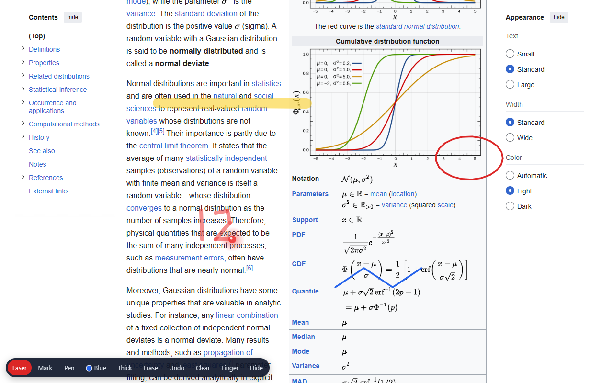

# WebPen Presenter

Draw on any web page while you share your screen. A laser pointer that remembers what
you just wrote, a highlighter, a pen, an eraser, all on top of the site you are teaching
from, with nothing to install on the students' side and nothing sent anywhere.



Made for an instructor on an iPad with an Apple Pencil, teaching a class over Zoom from
a textbook site, an online calculator, a news article, anything with a URL. Zoom shares
pixels, so a pencil hovering over a page is invisible to the room unless the page draws
it. This draws it.

## What it does

Tap the bar once and the pencil becomes a presenter tool while your fingers keep
scrolling, tapping and zooming the page underneath.

Laser is the one you leave on. A red dot follows the pencil, and when you press and
write, the strokes stay on screen together: "12 + 7 = 19" written stroke by stroke,
then the whole note fades two seconds after the last lift. A quick tap with the pencil
presses whatever button sits under the dot, so you point and click with the same hand.

Mark is a translucent yellow highlighter. Pen draws a red or blue line, Thick doubles
it, Erase rubs out part of a stroke, Undo takes back the last thing you did, Clear wipes
the page. Marks are anchored to the page, so they stay on the sentence you drew them
on when you scroll. Finger mode lets fingers and the mouse draw too, for a tablet
without a pen or a laptop with a trackpad.

The bar follows the visible area through pinch zoom, Split View and Stage Manager on
the iPad, and it survives a reload within the same tab.

## Get it

Two carriers, one file.

The bookmarklet is for the iPad. Open https://webpen-presenter.netlify.app/ once, follow
the numbered steps to turn a Safari bookmark into the tool, then tap that bookmark on
any page you are presenting. Works in every desktop browser too. Sites with a strict
Content Security Policy (GitHub, Wikipedia, YouTube, Google Docs) refuse it; most
teaching sites, news sites, Desmos, Khan Academy and Canvas LMS accept it.

The Chrome / Edge extension is for the computer. Load `extension/` unpacked from
`chrome://extensions` (Developer mode, Load unpacked). The toolbar button opens a popup
with the same tools as the bar for mouse users, and Alt+Shift+P shows or hides the bar
on the page. The extension does not care about a site's CSP, and it reaches into
iframes: a pencil over an embedded video or calculator still draws on top.

## How it is built

The whole overlay is `src/presenter.js`, one file with no dependencies. Drop it on any
site with a script tag and open the page with `?present=1`, or call `Presenter.show()`
from your own instructor check. If the site has overlays of its own that must stay on
top, give the script tag a `data-z-index` attribute.

A few things it gets right that took real iPads to learn:

- Everything lives in a shadow root on one host element appended to `<html>`, so a
  site's own CSS cannot restyle the bar and a transformed body cannot pin the canvas to
  the page.
- Geometry is measured against the visual viewport, never the layout viewport, and
  strokes are kept in page coordinates. iPad Safari moves the visual viewport inside the
  layout one during pinch zoom; a canvas sized from `innerWidth` drifts away from the
  pencil.
- Input listeners sit on `window` in the capture phase, ahead of anything the page
  registered on `document`, so drawing apps and maps never see the pencil while the bar
  is on, and the pencil's touch events are cancelled so Safari does not scroll.
- Inside an iframe the script builds no UI; it forwards pen points to the parent, which
  maps them through the iframe's box. The frame only switches that on when the carrier
  says so, never on a page's word.

Carriers talk to the file through `window.Presenter`: `enable`, `show`, `hide`,
`toggle`, `shown`, `set`, `clear`, `undo`, `viewport`, `state`, `onChange`, `inFrame`,
`frameState`.

## Working on it

```
python scripts/sync.py      # src/presenter.js -> extension/ and site/
netlify deploy --prod       # publish site/ (bookmarklet page + presenter.js)
python scripts/icons.py     # redraw the extension icons
```

Tests live in `tests/`: a Playwright rig that loads the extension into Chromium,
dispatches synthetic pen and mouse pointer events on real sites and local trap pages,
and reads the result back from the canvas pixel by pixel. See `tests/README.md`.
Anything about touch, pinch zoom or Safari still needs a real iPad.

`TRACKER.md` is the running log and the list of what is next. `store/listing.md` holds
the Web Store text and screenshots.

## Author and license

Made by Jose Mondragon. Free and open source under the MIT License; see `LICENSE`.
